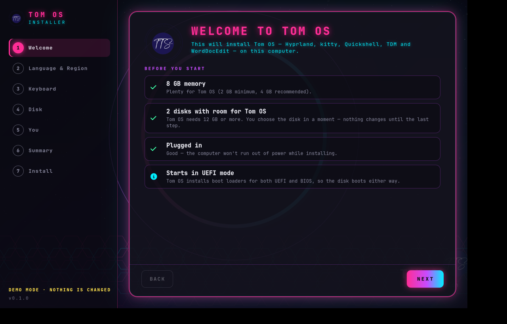
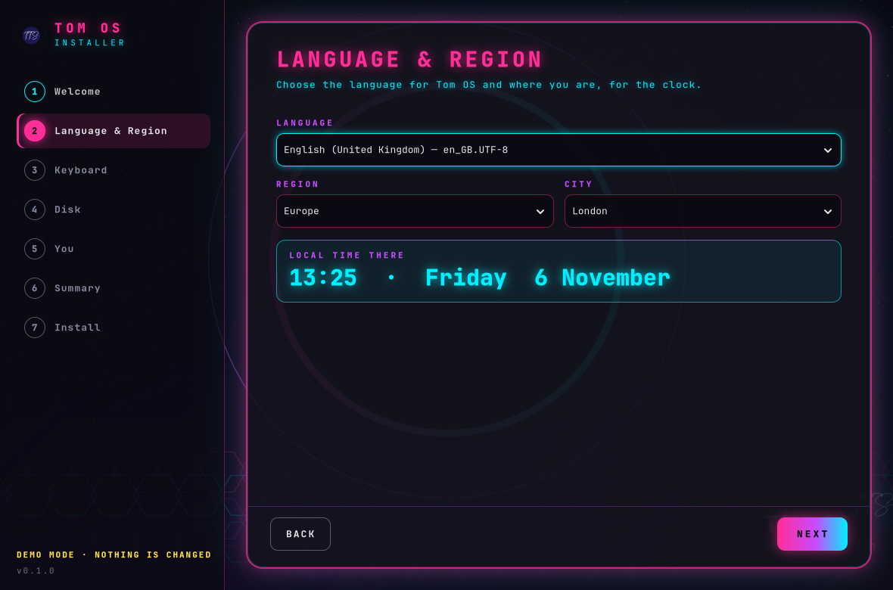
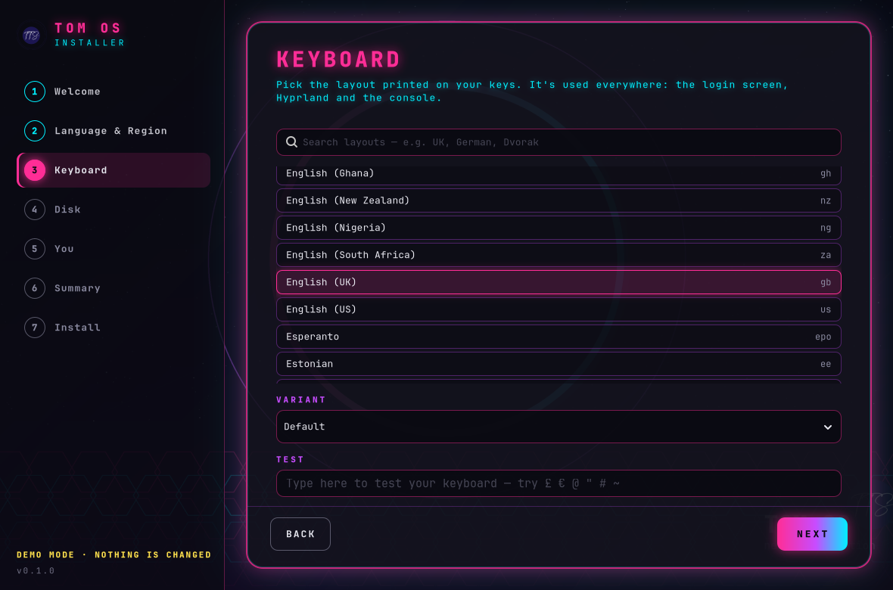
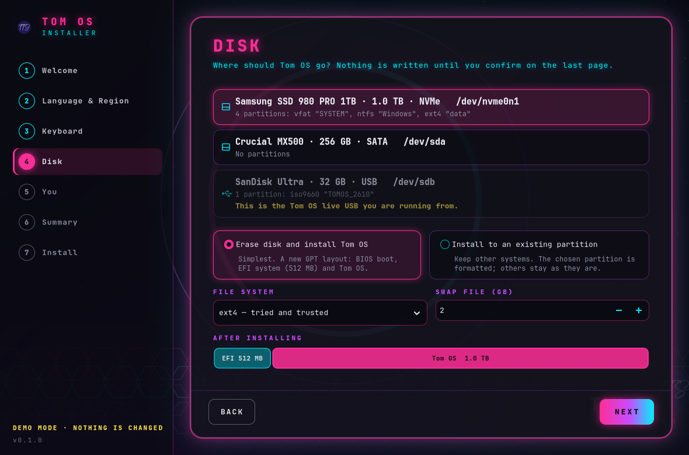
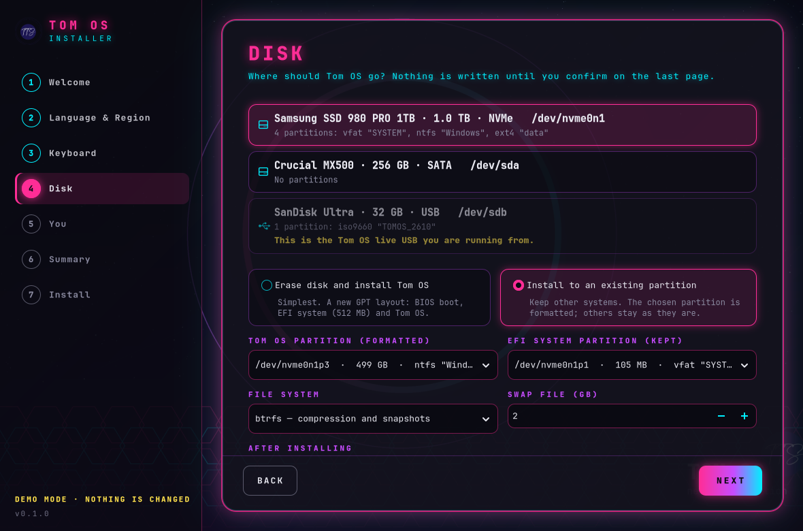
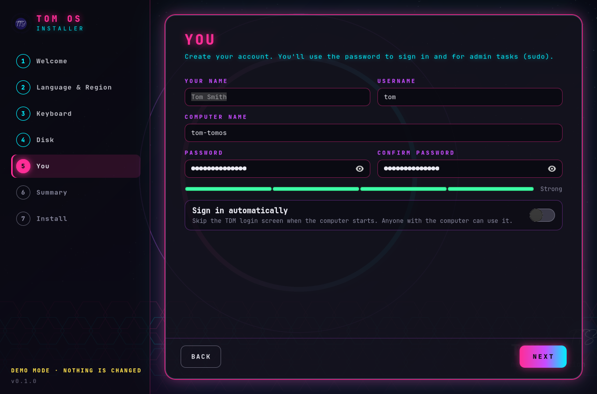
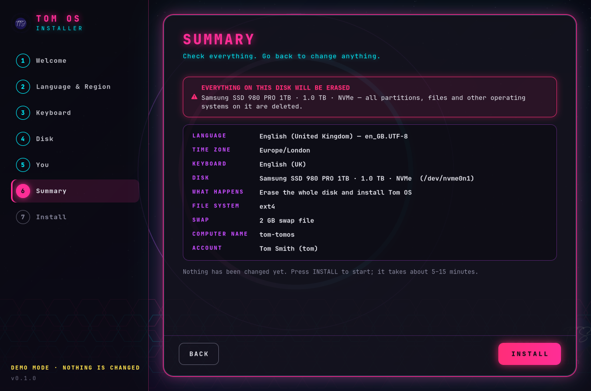
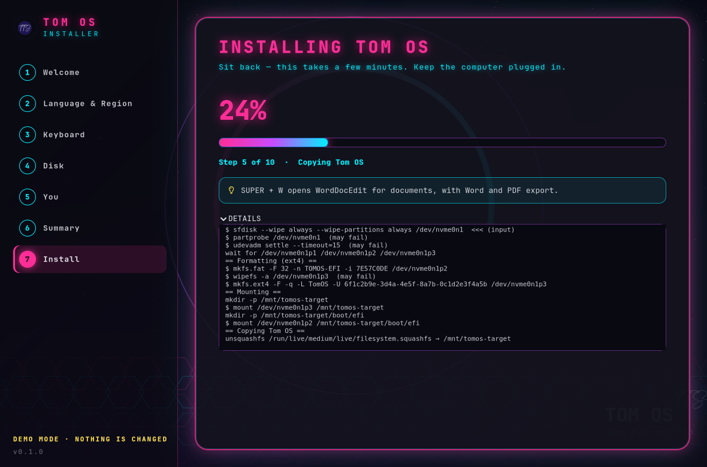
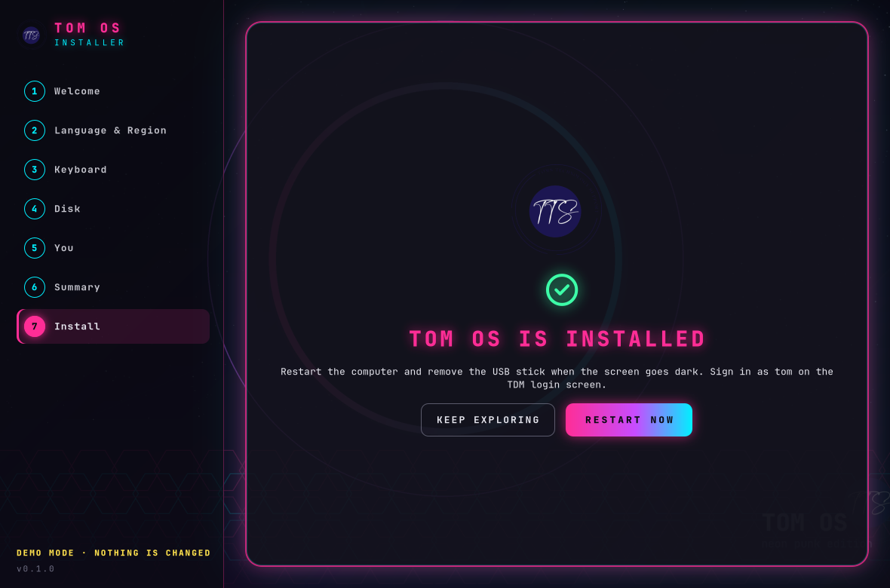
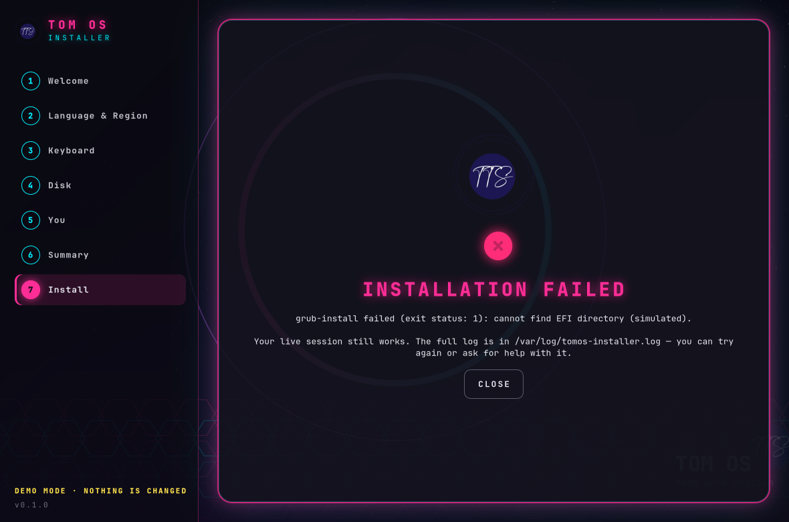

<p align="center">
  
</p>

# Tom OS Installer

A custom, neon-punk system installer for **[Tom OS](https://github.com/Spruhantom/tom-os-hyperland1)**, the Ubuntu-based Hyprland distribution. It is written in Rust with GTK 4 and uses the same look as TDM, the Tom OS login screen: deep navy, hot pink, cyan and purple, JetBrains Mono, and the Neon Eclipse wallpaper.

> **Status:** standalone project, version 0.1.0. It is **not yet built into the Tom OS ISO** (the ISO still ships Calamares). See [Adding it to the ISO](#adding-it-to-the-iso).

## Features

- **Seven clear steps** — Welcome → Language & Region → Keyboard → Disk → You → Summary → Install.
- **Welcome checks** — memory, a suitable disk, mains power and UEFI/BIOS boot mode.
- **Language & region** — every UTF-8 locale on the system, region and city time-zone pickers, and a live clock for the chosen place.
- **Keyboard** — searchable list of every XKB layout and variant, a test box, and (on the live session) the layout switches instantly in Hyprland. The choice is applied to the console, Hyprland and the TDM login screen.
- **Disk**
  - *Erase disk*: GPT with BIOS boot, a 512 MB EFI partition and Tom OS.
  - *Existing partition*: format one partition and keep everything else; reuse an existing EFI partition (dual boot with Windows), with the GRUB menu and os-prober turned on.
  - **ext4** or **btrfs** (subvolumes `@`, `@home`, `@swap`, zstd compression), and a swap file from 0–16 GB.
  - A drawn preview of the disk after installing.
  - The live USB is detected and can't be chosen.
- **You** — name, username (suggested from your name), computer name, password with a strength meter, and optional automatic sign-in.
- **Summary** — everything on one page with a clear red warning before a disk is erased, then a confirmation dialog.
- **Install** — big progress percentage, current step, Tom OS tips, and a details log.
- **Boots everywhere** — GRUB is installed for **both BIOS and UEFI** (plus the removable `EFI/BOOT/BOOTX64.EFI` path), so the disk starts on any PC.
- **Cleans up the live system** — removes live-boot, live-config, Calamares and the live launchers, and enables greetd/TDM and NetworkManager.
- **Safe by design** — the window never touches a disk; a root backend re-checks the plan, refuses the live USB and anything mounted, and keeps the password out of every log. See [docs/HOW-IT-WORKS.md](docs/HOW-IT-WORKS.md).
- **Demo mode** — `tomos-installer --demo` shows sample disks and simulates the install, so you can try it on any Linux desktop.

## Screenshots

| | |
|---|---|
|  **Welcome** — checks before you start |  **Language & Region** — with a live clock |
|  **Keyboard** — search, variant and test box |  **Disk** — erase a whole disk |
|  **Disk** — install beside Windows, btrfs |  **You** — account and password strength |
|  **Summary** — red warning before erasing |  **Installing** — progress, tips and log |
|  **Done** — restart into Tom OS |  **Failed** — a clear error and where the log is |

The screenshots come from the installer's `--demo` mode (same window, simulated disks and install).

## Using it

On the Tom OS live USB:

```sh
tomos-installer            # opens the installer; asks for admin rights when you press INSTALL
```

Try it without changing anything (any Linux with GTK 4.12+):

```sh
tomos-installer --demo                 # sample disks, simulated install
tomos-installer --demo --page 3        # open on a page (0–7), for screenshots
tomos-installer --demo --demo-fail     # see the error page
```

Other commands:

```sh
tomos-installer disks                              # disks as JSON
tomos-installer check-plan < plan.json             # validate a plan
sudo tomos-installer backend --dry-run < plan.json # print every step and command, change nothing
sudo tomos-installer backend < plan.json           # install without the window (JSON progress on stdout)
```

Options: `--source PATH` installs from a squashfs image or root directory instead of the live medium; `--allow-loop` offers loop devices (testing only).

Keyboard: every page works without a mouse — Tab between fields, **Alt+N** for Next, **Alt+B** for Back.

## Building

Needs Rust 1.83+ and GTK 4.12+ development files.

```sh
sudo apt install build-essential libgtk-4-dev     # Ubuntu / Debian / Tom OS
cargo build --release
cargo test                                        # 33 unit tests: plan checks, disk parsing, install steps
./target/release/tomos-installer --demo
```

## Testing status

- 33 unit tests pass (plan validation, lsblk parsing, live-USB detection, install step lists, simulated runs).
- Run in a Tom OS 26.10 live session in QEMU (UEFI, 16 GB virtio disk, btrfs): the preflight checks, GPT partitioning, formatting, btrfs subvolumes and mounting all worked, and copying the system had started. That test was stopped before the copy finished, so a complete install-and-reboot test still needs to be done. Please try it on a spare disk or a VM first.

The backend alone (no GTK needed): `cargo build --release --no-default-features`.

Make a Debian package:

```sh
packaging/build-deb.sh          # → target/deb/tomos-installer_0.1.0_amd64.deb
```

Runtime tools (all already in Tom OS): `util-linux`, `fdisk`, `dosfstools`, `e2fsprogs`, `btrfs-progs`, `squashfs-tools`, `rsync`, GRUB (`grub-pc-bin`, `grub-efi-amd64-bin`), `sudo` or `pkexec`.

## Adding it to the ISO

When you're ready to replace Calamares:

1. Install the `.deb` into the Tom OS chroot (or copy `tomos-installer` to `/usr/bin` and `data/tomos-installer.desktop` to `/usr/share/applications/`).
2. Point the Tom OS launcher at it: `/usr/bin/tomos-install` → `exec tomos-installer`.
3. Optionally remove `calamares`, `calamares-data` and `/etc/calamares`.
4. Rebuild the squashfs and ISO.

The installer already removes itself and Calamares from the installed system.

## Project layout

```
src/
  main.rs        command line
  plan.rs        the install plan + validation (usernames, hostnames, passwords, devices…)
  disks.rs       lsblk parsing, live USB detection, partition names
  catalog.rs     locales, keyboard layouts, time zones
  backend.rs     install steps, root runner, dry run, progress
  events.rs      JSON progress protocol
  gui/mod.rs     the window and pages
  gui/style.rs   Tom OS neon CSS
data/            desktop entry
docs/            how it works
packaging/       .deb build script
screenshots/
```

## Licence

MIT — see [LICENSE](LICENSE). Part of the Tom OS project: [tom-os-hyperland1](https://github.com/Spruhantom/tom-os-hyperland1) · [Tomos-display-manager](https://github.com/Spruhantom/Tomos-display-manager) · [tomos-worddocedit](https://github.com/Spruhantom/tomos-worddocedit).
